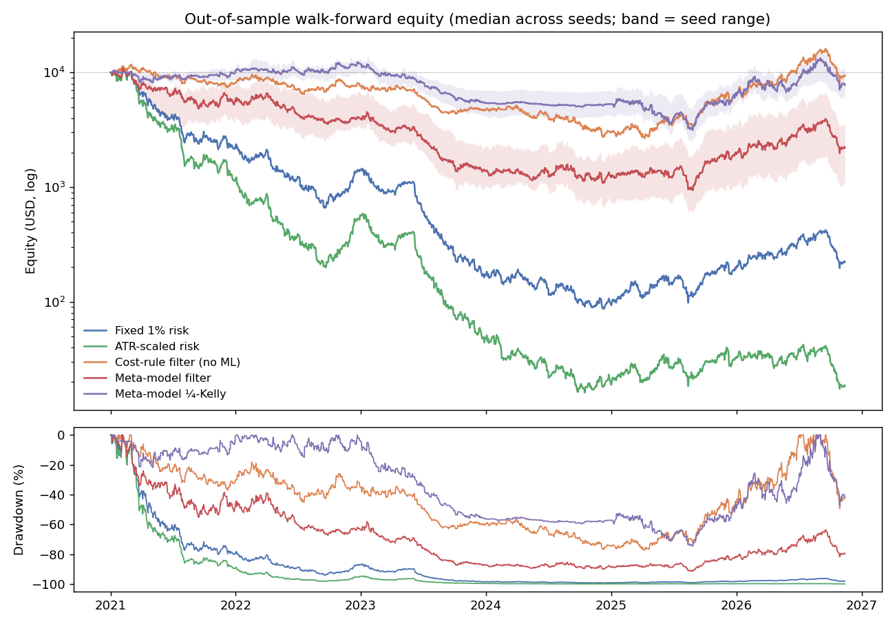
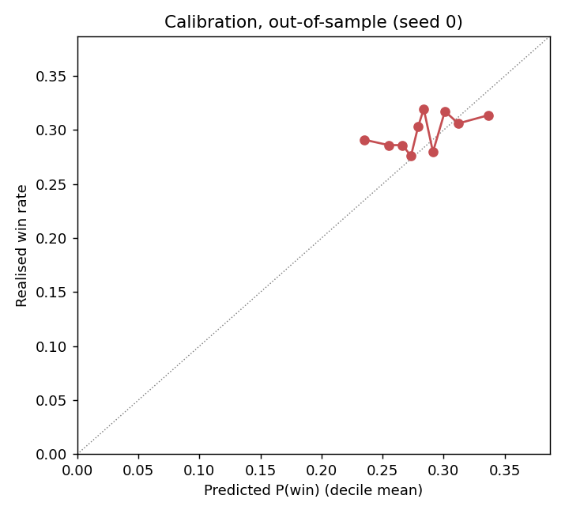
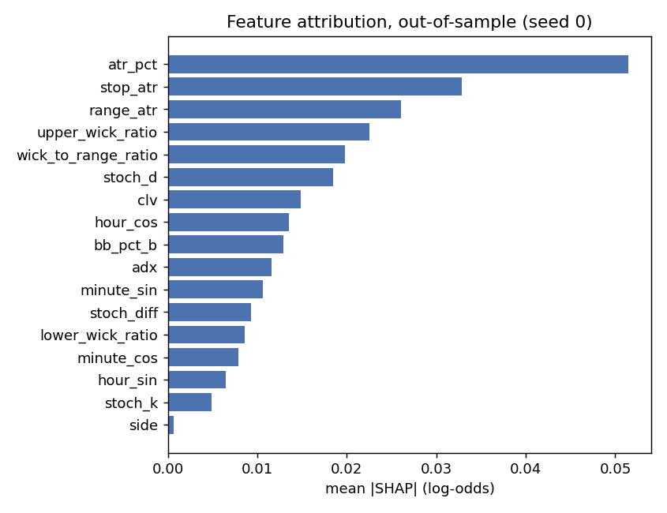
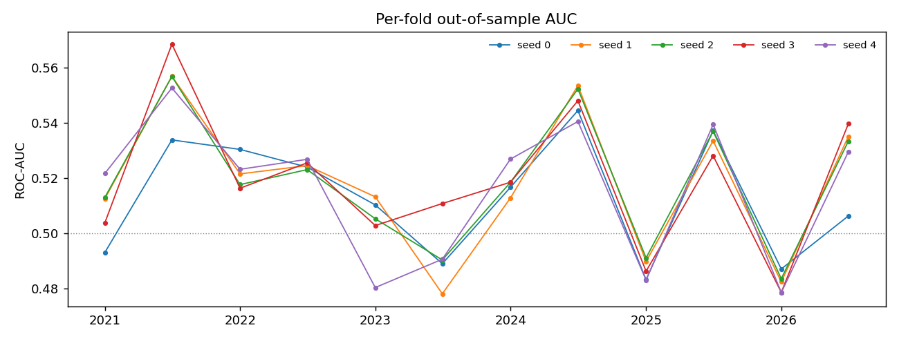

# xauusd-ml-risk

A **meta-labeling risk layer** for XAUUSD (spot gold). A primary strategy proposes trades. A gradient-boosted classifier estimates **P(win)** for each proposed trade, and that probability either **filters** the trade or **sizes** it with quarter-Kelly. The model is evaluated with **purged, embargoed walk-forward validation** against non-ML sizing baselines, including realistic broker costs.

**Headline result (honest negative).** On 2021-01 → 2026-11 out-of-sample data, the meta-model has **no meaningful predictive skill**:

- ROC-AUC is 0.519 ± 0.003, and the Brier skill score is 0.0001 ± 0.0007 against a base-rate predictor.
- It **does not beat a one-line non-ML rule** ("skip trades whose spread + commission is large relative to the stop"), which reaches AUC 0.537.
- Against fixed-1% sizing, the model's quarter-Kelly policy improves Sharpe. The non-ML rule improves it at least as much.

The pipeline, leakage controls and evaluation are the contribution here; the model is not. Everything below is reproducible from public data.

> This package was extracted from a private trading bot's ML layer and rewritten as a standalone project. The bot's own strategies, strategy-specific features, parameters, credentials and execution code are **not** included. Labels come from a deliberately simple, public **toy** primary strategy (EMA crossover). It exists only to produce a trade stream to grade, and it is not a trading recommendation.

---

## 1. Problem

Discretionary and systematic traders often have a signal that is right only some of the time. **Meta-labeling** (López de Prado, *Advances in Financial Machine Learning*, ch. 3) separates two decisions:

1. **Side**, from the primary model: long or short, plus where the stop and target go.
2. **Size**, from the meta-model: how likely this specific trade is to finish net-positive, and therefore how much to risk, including zero.

In the source bot, the meta-model's P(win) feeds a Kelly allocator: `risk = fraction · (b·p − q) / b`, capped. If the model is miscalibrated or has no skill, Kelly sizing turns that error directly into risk. The question this repo answers rigorously is: **does the meta-model add value over simple risk rules, out of sample, after costs?**

## 2. Data

| | |
|---|---|
| Source | [HistData.com](https://www.histdata.com/download-free-forex-historical-data/?/ascii/1-minute-bar-quotes/xauusd) free XAUUSD 1-minute bars (BID OHLC). Not redistributed here; `scripts/download_histdata.py` fetches it. |
| Period used | 2019-01-01 → 2026-11-13 (≈2.74M one-minute bars). First out-of-sample day: 2021-01-01. |
| Fields | `timestamp` (UTC bar open), `bid_open/high/low/close`. The loader also accepts full bid/ask data (`ask_*` columns), such as broker tick data aggregated to 1m. |
| Timezone | HistData documents "EST without DST". **For this data that is wrong.** The timestamps are UTC−5, shifted +1h while *European* summer time is in force. This was verified on 144 US 08:30-ET release spikes (NFP, CPI…): 143/144 land on the correct UTC minute, including 4/4 in the weeks when US and EU clocks disagree. Under fixed-EST, every summer bar would be off by one hour. `scripts/check_timezone.py` reproduces the check. |
| Spread | The source is bid-only, so ask = bid + **modelled spread**, a flat **$0.20/oz**. That is the upper end of the live Fusion Markets Zero XAUUSD spread seen by the source bot (~$0.09–0.20). A Dukascopy retail bid/ask sample measured ~$0.30, flat across hours. Sensitivity: **2× spread ($0.40)**, reported below. |
| Costs | Fusion Markets **Zero** account: **$2.25 commission per side per lot** (100 oz), plus spread embedded in every fill (longs buy at ask and sell at bid). Optional extra slippage is configurable; it is 0 in the reported runs. |
| Preprocessing | Drop duplicate timestamps, non-positive prices, crossed quotes and inconsistent OHLC. Resample to 5-minute bars, left-labelled and left-closed. A 5m bar labelled 10:00 is only *observable* at 10:05 (`close_time`), and that is the decision time. |
| Bundled sample | `data/sample/xauusd_synthetic_1m.csv.gz`: 6 months of **synthetic** 1m bid/ask (a GARCH-style random walk), so the full pipeline and tests run from a fresh clone. It has no price signal, but it does have a *cost* signal. |

## 3. Primary model (toy) and labels

- **Signal:** EMA(20) crosses EMA(50) on 5m mid closes → long (cross up) or short (cross down).
- **Stop:** 10-bar swing low (long) or swing high (short), signal bar included. **Target:** 2.5R.
- **Entry:** the first 1m bar open after the signal bar closes. The signal is skipped if that is more than 5 min later (weekend or daily break), or if the stop is smaller than 2× spread.
- **Exits** are simulated on 1m bid/ask bars:
  - If stop and target are touched in the same minute, the **stop fills first** (conservative).
  - A gap through the stop fills at the minute's open.
  - A 2-day time exit bounds the label horizon. It fired on 6.4% of trades.
- **Label:** `y = 1` if the trade's **net** R-multiple (after spread and commission) is > 0. Each sample spans `[decision_time, exit_time]`.

The stream has **10,813 trades** (7,969 out-of-sample), a median hold of 149 min, and an OOS win rate of 29.8%. Average R per trade is −0.024 gross and −0.037 net, so **the toy strategy has negative expectancy**. The meta-model's job is to find the subset or sizing that fixes that, if one exists.

## 4. Features

All features are computed on **closed** 5m bars and known at the decision time. `tests/test_features_no_lookahead.py` proves causality, as described in §6.

| feature | description |
|---|---|
| `hour_sin`, `hour_cos`, `minute_sin`, `minute_cos` | time of day (UTC, at bar close), cyclically encoded |
| `atr_pct` | ATR(20) / close: volatility as a fraction of price, which stays stationary while gold doubled |
| `range_atr` | signal-bar range / ATR(20) |
| `upper_wick_ratio`, `lower_wick_ratio`, `wick_to_range_ratio` | wick sizes as a fraction of the bar range |
| `clv` | close location value, (close − low)/(high − low) |
| `bb_pct_b` | Bollinger %B (20, 2σ) |
| `stoch_k`, `stoch_d`, `stoch_diff` | Stochastic (14, 3, 3) and K − D |
| `adx` | Wilder ADX(14) |
| `side` | primary signal side (+1/−1), from the public toy model |
| `stop_atr` | stop distance / ATR(20), from the public toy model |
| `spread_atr` | spread / ATR. **Disabled** for the bid-only data, because a modelled constant spread carries no information. Enable it with real bid/ask data. |

These are the strategy-agnostic subset of the source bot's features, re-implemented in Python. Two deliberate changes:
- ATR is price-normalised; the bot used absolute pips, which is non-stationary.
- Strategy-coupled features (signal strength, signal streaks, HTF momentum, strategy-specific EMA distance) were removed.

## 5. Model and training

- **LightGBM 3.3.5**, binary log-loss, `feature_fraction = bagging_fraction = 0.8`, λ₂ = 1, learning rate 0.03, and `deterministic=True` with a single thread. LightGBM is pinned at 3.3.5 because the bot loads models with Go's [`dmitryikh/leaves`](https://github.com/dmitryikh/leaves), which reads the v3 text format.
- **Tuned only inside each training window:** `max_depth ∈ {3, 5}` (with `num_leaves = 2^depth − 1`), `min_data_in_leaf ∈ {100, 400}`, the number of boosting rounds (via early stopping), and the filter threshold.
- **Exported artifacts** use exactly the bot's contract: `<name>.txt` (LightGBM model), `<name>_features.json` (sorted feature list), plus `<name>_meta.json` (params, threshold, data range, run provenance).

## 6. Validation and leakage control

**Outer walk-forward** (`ml_risk/splits.py`):
- Expanding training window with a 24-month minimum, then 6-month test windows: **12 folds**, 2021-01 → 2026-11.
- Training data never comes from after the test window.

**Purging and embargo.** A training sample `i` is kept only if:
- `exit_time_i < test_start`: its label is fully resolved before the test window opens.
- `decision_time_i < test_start − embargo`: this removes samples whose features sit right next to the window.

The embargo is the maximum possible trade duration, 2 days.

**Nested selection, all inside the training window:**
1. Build 3 inner walk-forward folds, each purged and embargoed the same way.
2. In each inner fold, the purged tail of inner-train is used **only** for early stopping. The inner-validation block is used **only** for selecting params by log-loss and choosing the filter threshold, so early stopping doesn't bias selection.
3. Refit on the whole training window with the chosen params and the median best-iteration.
4. Predict the untouched test window once.

**Seeds.** The entire walk-forward is repeated for **5 seeds** (0–4). Results are reported as mean ± std.

**Tests that enforce the above:**
- *Truncation invariance:* features at bar t computed on `bars[:t+1]` equal those computed on the full series (25 random t).
- *Future perturbation:* scrambling every bar after t leaves features ≤ t unchanged, and verifiably changes later ones.
- *Signal causality:* the same perturbation test applied to the primary signal.
- *Split invariants:* no training label overlaps a test or validation window, the embargo holds, and folds are disjoint and time-ordered, for both outer and inner folds.
- *Trade simulator:* hand-computed cases cover TP, stop-first ties, gap fills, the short side using ask, and entry and stop filters.
- *Reproducibility:* identical predictions from two seeded fits.
- *Go parity:* the exported model loaded with the bot's Go library (`tools/go_parity`, `leaves.LGEnsembleFromFile(path, true)`) gives the same probabilities as Python (|Δ| < 1e-9). On the real model, the max |Δ| was 5.6e-17 over 500 rows.

**Leakage issues found in the original bot's ML layer, and how this repo avoids them:**

| issue in source bot | here |
|---|---|
| Single 70/30 time split, no purge or embargo | 12-fold purged and embargoed walk-forward |
| "OOS" backtest window overlapped the training data | test windows strictly after training, enforced by tests |
| Training-data exporter only appends to one file, so rows can accumulate as duplicates across runs and parameter-sweep combos | dataset rebuilt deterministically from raw bars and cached by content hash |
| Train/serve feature-name mismatch (one model would have received all-zero inputs at inference; the layer was not enabled live) | sorted schema contract, a `strict=True` mode that raises on missing keys, and a Go parity test |
| Raw price used as a feature | price-normalised features only |
| No random seeds | all seeds fixed; 5-seed stability reported |

## 7. Sizing policies compared (identical trades, identical stops and targets)

| policy | rule |
|---|---|
| **Fixed 1%** | risk 1% of equity on every trade |
| **ATR-scaled** | 1% × clip(trailing-20-day median ATR% / current ATR%, 0.5, 2) |
| **Cost rule (no ML)** | 1% if `−(spread + commission) / stop distance` ≥ threshold, else skip. The threshold is chosen on the training window. |
| **Meta-model filter** | 1% if P(win) ≥ threshold, else skip. The threshold is chosen in-train (it maximises inner-validation net R while keeping ≥ 25% of trades). |
| **Meta-model ¼-Kelly** | `0.25 · (b·p − (1−p)) / b`, capped at 2%, skip if ≤ 0. Here `b = (2.5 − cost_R)/(1 + cost_R)` is the trade's net payoff ratio. |

**Equity simulation:**
- Starting equity is $10,000; trades are sized off realised equity at entry, and overlapping trades are allowed.
- Lots are fractional, so a minimum-lot floor doesn't distort the comparison once equity shrinks.
- Sharpe and Sortino use business-day returns, annualised √252.
- **Risk-weighted R** = Σ fᵢRᵢ / Σ fᵢ is a scale-free check on whether a policy puts more risk on better trades. It matters because a policy can look better simply by betting less on a losing stream.

## 8. Results

All numbers are real outputs of `python -m ml_risk.evaluate` on the HistData set. Full tables are in [`reports/xauusd_histdata_2019_2026/metrics.md`](reports/xauusd_histdata_2019_2026/metrics.md), and the 2× spread sensitivity is in [`reports/xauusd_histdata_2019_2026_spread_x2/metrics.md`](reports/xauusd_histdata_2019_2026_spread_x2/metrics.md).

Setup: out-of-sample 2021-01-01 → 2026-11-13, 12 folds, 7,969 OOS trades, 5 seeds, mean ± std.

### Prediction quality (pooled out-of-sample)

| | ROC-AUC | Brier | Log-loss | Brier skill |
|---|---|---|---|---|
| **Meta-model (LightGBM)** | **0.519 ± 0.003** | 0.2094 | 0.6097 | **0.0001 ± 0.0007** |
| Base-rate predictor (train-window win rate) | 0.5 | 0.2094 | 0.6097 | 0 |
| Logistic regression, same features and folds (reference) | 0.524 | – | – | – |
| Cost-rule score alone (no fitting) | **0.537** | – | – | – |

Per-fold AUC ranges from 0.48 to 0.54. Early stopping on the purged inner folds keeps few trees (per-seed medians of 24–43 at learning rate 0.03), the predictions barely leave the base rate (0.23–0.35), and calibration is flat. That is the signature of no learnable signal beyond cost structure. SHAP ranks `atr_pct` and `stop_atr` highest, both of which are proxies for how large costs are relative to the stop.

### Trading impact (Fusion Zero costs, modelled spread $0.20)

| policy | trades | avg risk | win rate | risk-weighted R | total return | max DD | Sharpe | Sortino |
|---|---|---|---|---|---|---|---|---|
| Fixed 1% | 7,969 | 1.00% | 29.8% | −0.037 | −97.8% | 99.2% | −0.81 | −1.08 |
| ATR-scaled | 7,969 | 1.08% | 29.8% | −0.059 | −99.8% | 99.9% | −1.23 | −1.60 |
| **Cost rule (no ML)** | 3,931 | 1.00% | 32.0% | **+0.009** | −7.1% | 77.9% | **0.16** | **0.24** |
| Meta-model filter | 4,911 ± 277 | 1.00% | 30.4% | −0.023 ± 0.008 | −79.5 ± 9.8% | 91.2 ± 4.2% | −0.40 ± 0.15 | −0.56 ± 0.21 |
| Meta-model ¼-Kelly | 3,036 ± 63 | 0.74% | 31.1% | +0.003 ± 0.010 | −18.2 ± 19.0% | 72.5 ± 5.6% | 0.04 ± 0.12 | 0.07 ± 0.18 |

Moving-block bootstrap (20-day blocks, 2,000 resamples) of the Sharpe difference, with ranges across the 5 seeds:
- **Meta ¼-Kelly vs fixed:** ΔSharpe +0.72 to +0.99. The share of resamples ≤ 0 is 0.01–0.03.
- **Cost rule vs fixed:** +0.97, with a 95% CI of [+0.33, +1.58].
- **Meta ¼-Kelly vs cost rule:** −0.25 to +0.02, with a share ≤ 0 of 0.46–0.76. No evidence the model adds anything beyond the rule.
- **Meta filter vs cost rule:** −0.72 to −0.36, with a share ≤ 0 of 0.89–0.99. The rule is better.

**2× spread sensitivity ($0.40):** the conclusions are unchanged.
- Meta-model AUC is 0.537 ± 0.001 against 0.554 for the cost-rule score.
- Every policy loses money.
- The cost rule again has the best risk-weighted R (−0.013) and Sharpe (−0.19), against −0.046 and −0.43 for ¼-Kelly.



| calibration (OOS) | SHAP (OOS) | per-fold AUC |
|---|---|---|
|  |  |  |

### Interpretation

- The meta-model's apparent edge over fixed sizing comes from **avoiding trades whose costs are large relative to the stop**. A transparent rule captures that as well or better, without fitting anything. The same pattern appears on the synthetic random walk: AUC is about 0.60 for both the model and the rule, while shuffled labels give 0.525.
- ATR-scaled sizing **hurts** on this stream (risk-weighted R −0.059 against −0.037). It moves risk towards low-volatility trades, and in this sample those trades did worse than average.
- The meta-model cannot turn a negative-expectancy toy signal into a profitable one. Per-year net R for the stream is negative in 2021–2024 and positive in 2025–2026 (+0.065 and +0.021), and that regime shift dominates the equity curves.
- The **Kelly policy depends heavily on calibration**. With predictions compressed around the base rate, it behaves like a threshold filter at p ≈ 1/(1 + b), and it doesn't size trades meaningfully.

## 9. Limitations

- **Single instrument and timeframe** (XAUUSD, 5m). One toy primary strategy; a different primary signal could carry more learnable meta-information.
- **Modelled, not observed, spread.** The spread is flat at $0.20, with a $0.40 sensitivity. It ignores rollover and news-time widening, which would hurt all policies and especially the small-stop trades. With real bid/ask ticks, the `spread_atr` feature and an observed spread can be switched on.
- **Execution assumptions:** fills at the touch, no slippage beyond spread (configurable), a conservative stop-first rule within each minute, no partial fills, no swap or financing costs, and no margin constraints.
- **Data:** a free vendor feed with documented, and here corrected, timezone quirks. **The 2023 file has 542 intraday gaps (>10 min, outside the daily break) totalling about 704 missing hours**, against 4–13 gaps per year otherwise. The simulator crosses gaps with gap fills, and features span them. 2023 is also the stream's worst OOS year (net −0.157 R per trade). It is kept in the evaluation rather than removed after seeing results; treat the 2023 fold as lower-quality data.
- **Overlapping labels.** Trades can overlap in time. Purging handles leakage, but samples aren't uniqueness-weighted, so the effective sample size is below the 10.8k rows.
- **Statistical power:** about 660 OOS trades per fold. An AUC of 0.52 is within a fold-to-fold noise band of about ±0.03.

## 10. How to run

```bash
# 1. environment (conda recommended: lightgbm 3.3.5 has no pip wheel for Apple Silicon)
mamba env create -f environment.yml        # or: conda env create -f environment.yml
conda activate xauusd-ml-risk
pip install -e .

# 2. sample pipeline (bundled synthetic data, ~1 min)
python -m ml_risk.train    --config configs/sample.yaml
python -m ml_risk.evaluate --config configs/sample.yaml      # -> reports/synthetic_sample/
pytest -q

# 3. full run on public data
python scripts/download_histdata.py --start-year 2019 --end-year 2026 --out ../xauusd-ml-data/histdata
python scripts/check_timezone.py ../xauusd-ml-data/histdata  # must report ≥98% matches
python -m ml_risk.evaluate --config configs/default.yaml     # walk-forward, 5 seeds (~30 s)
python -m ml_risk.evaluate --config configs/spread_x2.yaml   # cost sensitivity
python -m ml_risk.train    --config configs/default.yaml     # deployable model on all data

# 4. optional: verify the bot's Go loader reads the exported model identically
cd tools/go_parity && go run . -model <model.txt> -features <model_features.json> -input rows.json
```

**Inference** uses the same interface the bot calls:

```python
from ml_risk.inference import MetaModel, features_for_signal, kelly_risk_fraction
mm = MetaModel.load("xauusd_meta.txt")                 # reads xauusd_meta_features.json alongside
p = mm.predict(features_dict)                          # P(win); missing keys -> 0.0 exactly like the Go filter
risk = kelly_risk_fraction(p, b=2.5, fraction=0.25, max_risk=0.02)
```

**Reproducibility.** Every report directory contains `run_info.json` with the git commit, package versions, a digest of the input files, and the full resolved config. Seeds are fixed in the config; LightGBM runs deterministically on a single thread.

## Repository layout

```
configs/            default.yaml (HistData), spread_x2.yaml (sensitivity), sample.yaml (synthetic)
data/sample/        synthetic 1m bid/ask sample (no real market data)
scripts/            download_histdata.py, download_dukascopy.py (bid/ask alternative; resumable, but Dukascopy
                    rate-limits heavily and a full 2019–2026 pull was never completed), check_timezone.py,
                    make_synthetic_sample.py
src/ml_risk/        data · features · primary (toy) · labels · splits · model · backtest ·
                    train · evaluate · inference · pipeline · config
tests/              lookahead, split, simulator, inference/Go-parity and end-to-end tests
tools/go_parity/    Go program that loads models exactly like the bot (dmitryikh/leaves)
reports/            aggregated metrics, tables and plots (no per-trade data)
```
